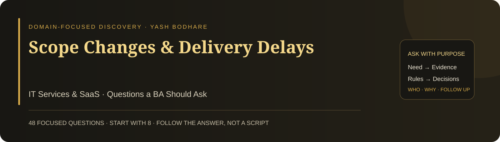

# Scope Changes & Delivery Delays

**Domain:** IT Services & SaaS · **48 focused questions** · **Eight suggested opening priorities**

A practical questioning guide for a Business Analyst investigating this case. Each question has a suggested stakeholder and a clear discovery purpose. Ask one question, listen, and follow the answer. The full bank is a reference—not a checklist to read in one meeting.

## 🎯 Case and decision

Frequent requirement changes increase project costs and delay delivery. Determine whether changes reflect legitimate learning, unclear requirements, weak decision rights, or underestimated dependencies. Avoid treating all change as bad or assuming that another tracking tool will solve governance.

**Decision to support:** Agree which changes to accept, defer, split, or reject using value, impact, dependencies, and authorised decisions.

The case trigger comes from Yash Bodhare’s portfolio card. Detailed processes, causes, obligations, targets, and systems have not been supplied. These questions help discover them; they do not assume that a particular solution or root cause has already been verified.

## 👥 People to involve

| Contact | What they can clarify |
| --- | --- |
| Sponsor / client decision owner | Intended value, commitments and priorities |
| Product owner / delivery lead | Scope, sequencing, release decisions |
| Users / client representatives | Actual needs and acceptance expectations |
| BA, engineering and QA | Requirement interpretation, dependencies and test impact |
| Commercial and Finance owners | Agreement boundaries, costs and approvals |
| Support / customer success / security | Operational readiness and control needs |

These are suggested participants to confirm, not a claim about an existing organisation’s roles. Start with the accountable process owner, then follow the relevant handoffs and affected users.

## ⚡ Start here: eight opening priorities

Use these as a starting route. If the stakeholder’s answer changes the direction, adapt rather than continuing mechanically. Click an ID for the complete question below.

| Order | Question | Suggested contact | Why start here |
| --- | --- | --- | --- |
| 1 | [IT01](#it01) | Sponsor / Client owner | Links delivery urgency to value. |
| 2 | [IT02](#it02) | Delivery / Commercial owner | Separates new needs from clarifications and defects. |
| 3 | [IT03](#it03) | Product / Delivery owner | Establishes the reference for impact analysis. |
| 4 | [IT05](#it05) | Delivery / Analytics | Prioritises material impact over request volume. |
| 5 | [IT07](#it07) | BA / Delivery lead | Reveals the actual governance path. |
| 6 | [IT12](#it12) | Delivery / Engineering | Challenges a single-cause explanation. |
| 7 | [IT21](#it21) | Delivery / Commercial owner | Tests informed agreement. |
| 8 | [IT38](#it38) | Governance / Commercial owner | Identifies the accountable approval route. |

## 🧭 Question bank

### 01 · Outcome and scope-change definitions

| ID | Question to ask | Ask | What it clarifies |
| --- | --- | --- | --- |
| **IT01** | What business outcome is the delayed delivery meant to enable? | Sponsor / Client owner | Links delivery urgency to value. |
| **IT02** | What is counted as a scope change in the current reports? | Delivery / Commercial owner | Separates new needs from clarifications and defects. |
| **IT03** | Which agreed scope or release baseline are we comparing against? | Product / Delivery owner | Establishes the reference for impact analysis. |
| **IT04** | Which delivery commitment is currently at risk? | Delivery / Sponsor | Defines the immediate decision deadline. |
| **IT05** | Which changes have caused the largest demonstrable rework or delay? | Delivery / Analytics | Prioritises material impact over request volume. |
| **IT06** | What would be the consequence of delivering the original scope unchanged? | Client / Product owner | Tests whether change is necessary for value. |

### 02 · Change journey and delay evidence

| ID | Question to ask | Ask | What it clarifies |
| --- | --- | --- | --- |
| **IT07** | Can we follow one recent change from request to release decision? | BA / Delivery lead | Reveals the actual governance path. |
| **IT08** | Where does a change request wait longest for clarification or approval? | BA / Decision owners | Locates decision latency. |
| **IT09** | What evidence separates late discovery from unapproved expansion? | BA / Client owner | Distinguishes learning from weak control. |
| **IT10** | Which delivery estimate changed after the scope was understood more clearly? | Engineering / Delivery lead | Tests estimation assumptions rather than blaming change. |
| **IT11** | How is work interrupted when a new request arrives during implementation? | Engineering / QA | Reveals switching and partial-work costs. |
| **IT12** | Which dependencies caused delay even when requirements did not change? | Delivery / Engineering | Challenges a single-cause explanation. |

### 03 · Requirements, rules and completeness

| ID | Question to ask | Ask | What it clarifies |
| --- | --- | --- | --- |
| **IT13** | What evidence shows that the requested feature addresses a real user need? | Client / Users | Prevents accepting a solution without its rationale. |
| **IT14** | Which terms or rules in the disputed requirement remain ambiguous? | BA / Users / QA | Identifies the missing understanding. |
| **IT15** | What examples and exceptions did reviewers use when agreeing the requirement? | BA / Client reviewers | Checks the depth of validation. |
| **IT16** | Which acceptance conditions changed with the new request? | Product / QA | Defines the changed delivery expectation. |
| **IT17** | What happens when a client request contradicts an agreed business rule? | Product / Rule owner | Defines conflict resolution authority. |
| **IT18** | Which assumptions were treated as confirmed when work began? | BA / Engineering | Surfaces hidden commitments. |

### 04 · Client collaboration and expectation management

| ID | Question to ask | Ask | What it clarifies |
| --- | --- | --- | --- |
| **IT19** | Who represents the users affected by the requested change? | Client / Product owner | Finds input beyond the sponsor. |
| **IT20** | How do client representatives reach one agreed priority when they disagree? | Client decision owner | Clarifies internal client governance. |
| **IT21** | How are delivery consequences explained before a client approves a change? | Delivery / Commercial owner | Tests informed agreement. |
| **IT22** | Which status updates help the client understand unresolved scope decisions? | Client / Delivery lead | Clarifies useful communication. |
| **IT23** | How is a rejected or deferred request explained to its requester? | Product / Client owner | Maintains trust and a clear decision trail. |
| **IT24** | Who can confirm that the client understood the trade-off being accepted? | Client decision owner | Establishes credible confirmation. |

### 05 · Versions, traceability and technical dependencies

| ID | Question to ask | Ask | What it clarifies |
| --- | --- | --- | --- |
| **IT25** | Where is the current authoritative requirement version maintained? | BA / Product owner | Prevents conflicting implementation sources. |
| **IT26** | How are superseded requirements made visible to delivery teams? | BA / Engineering | Avoids work from outdated instructions. |
| **IT27** | Which stories, interfaces, tests, and operating procedures depend on this change? | BA / Engineering / QA | Defines impact coverage. |
| **IT28** | What external system or vendor agreement must change with the request? | Integration / Delivery owner | Exposes external dependencies. |
| **IT29** | How is the change linked to its approval and intended release? | Product / Configuration owner | Defines traceability of the decision. |
| **IT30** | What evidence is available to reconstruct why the current scope was chosen? | BA / Governance owner | Supports accountable review of past choices. |

### 06 · Quality, security and release readiness

| ID | Question to ask | Ask | What it clarifies |
| --- | --- | --- | --- |
| **IT31** | Which quality conditions remain mandatory despite delivery pressure? | Engineering / QA / Security | Protects agreed completion standards. |
| **IT32** | What security or privacy review is triggered by the proposed change? | Security / Privacy owner | Identifies required specialist involvement. |
| **IT33** | What operational support must be ready for the new behaviour? | Support / Delivery owner | Defines readiness beyond development. |
| **IT34** | What happens if a change cannot be completed without endangering the release objective? | Product / Delivery owner | Defines a bounded delivery decision. |
| **IT35** | Which users need a migration or training step because of the change? | Users / Support | Identifies transition requirements. |
| **IT36** | What rollback or recovery capability is needed for the changed workflow? | Engineering / Operations | Clarifies failure recovery before release. |

### 07 · Value, scope and decision authority

| ID | Question to ask | Ask | What it clarifies |
| --- | --- | --- | --- |
| **IT37** | Which value would this change add compared with the next-best use of capacity? | Product / Sponsor | Makes opportunity cost explicit. |
| **IT38** | Who has authority to accept the change and its delivery consequences? | Governance / Commercial owner | Identifies the accountable approval route. |
| **IT39** | Which cost or date changes require a revised commercial agreement? | Commercial / Finance | Clarifies contract-impact boundaries. |
| **IT40** | What scope can be deferred while preserving a useful release? | Product / Users | Supports coherent incremental delivery. |
| **IT41** | What evidence would justify declining the requested change? | Sponsor / Product owner | Makes rejection criteria transparent. |
| **IT42** | When will unresolved change decisions be escalated? | Delivery / Governance owner | Defines an actionable decision deadline. |

### 08 · Acceptance and delivery-learning measures

| ID | Question to ask | Ask | What it clarifies |
| --- | --- | --- | --- |
| **IT43** | Which acceptance scenarios must be updated before the changed work is tested? | QA / BA | Prevents stale coverage. |
| **IT44** | Who will validate that the revised scope still meets the intended user outcome? | Users / Product owner | Checks value after trade-offs. |
| **IT45** | How will release evidence show which approved requirement version was implemented? | QA / Configuration owner | Confirms alignment between decision and delivery. |
| **IT46** | How will we distinguish legitimate learning from avoidable requirement rework in review? | BA / Delivery owner | Defines a fair improvement measure. |
| **IT47** | Which delivery and quality measures should accompany change counts? | Delivery / QA | Avoids rewarding suppression of useful change. |
| **IT48** | Who will review whether the change delivered its expected benefit? | Product / Sponsor | Keeps value assessment after release. |

## 🔎 Turn a vague answer into useful discovery

The examples below are practice cues, not real stakeholder statements. Ask the next question because of what you heard—not because it appears next in a list.

| Stakeholder says | Focused next question | Evidence to seek |
| --- | --- | --- |
| “The client keeps changing everything.” | Which request changed an agreed requirement rather than clarified it? | Trace one example, including rationale, baseline, impacted work, and decision owner. |
| “This must be in the next release.” | What business consequence makes that date essential? | Separate a genuine deadline from preference, then compare feasible scope trade-offs. |
| “Requirements were already signed off.” | Which version and examples were agreed? | Confirm whether the current issue is a new need, an incomplete interpretation, or a defect. |

## 🧩 Produce only what supports a decision

- A change register with rationale, impact, authority, and decision, to govern acceptance or deferral.
- A linked requirement-version and test map, to avoid inconsistent implementation.
- A value-and-capacity comparison, to choose a useful revised release.

**Draft acceptance example to validate:** Given an approved requirement change, when it is scheduled for a release, then the authoritative requirement, affected acceptance scenarios, and decision record reference the same approved version. This is a draft governance criterion to agree with the delivery team.

This is an illustrative requirement conversation, not an approved specification or an executed test. Ask the responsible owner to confirm the rule and exceptions.

## 📊 Measures to define with stakeholders

| Candidate measure | Definition to agree |
| --- | --- |
| Decision latency | Elapsed time from a sufficiently described change request to an authorised decision; track clarification waits separately. |
| Avoidable rework | Effort attributable to confirmed misunderstanding or version conflict, distinguished from legitimate new learning. |
| Delivery guardrails | Usable outcome completion, agreed quality evidence, missed commitments, and cost impact; no change-count target alone. |

Agree the population, start/stop events, denominator, baseline period, target if needed, source, and owner. A metric label alone is not a reliable measure.

## 🗣️ Close the discussion clearly

“I understand that the priority is [outcome], the current difficulty occurs at [verified step], and the key rule is [confirmed rule]. We still need [evidence or decision]. Have I captured this correctly? Who should confirm the open point, and when can we review it?”

Use this as a speaking template and populate it with what the stakeholder actually said. Record facts, interpretations, assumptions, and unresolved questions separately. Silence is not confirmation.

## 🏋️ Practise the questioning skill

1. Pick one stakeholder and a ten-minute practice window.
2. Ask one opening question without reading its purpose aloud.
3. Listen, paraphrase the answer, and ask a relevant follow-up.
4. Request an example or evidence when the answer remains vague.
5. Summarise a need, a rule, and an unresolved point—only if discovered.

Review whether your questions were neutral, specific, useful to the decision, and responsive to the previous answer. Do not measure skill by how many questions you asked. A stakeholder can genuinely not know an answer; identify who or what could verify it.

[Source and scope notes](SOURCES.md)

---

**Ask with purpose · Listen carefully · Confirm the meaning · Follow the evidence**
